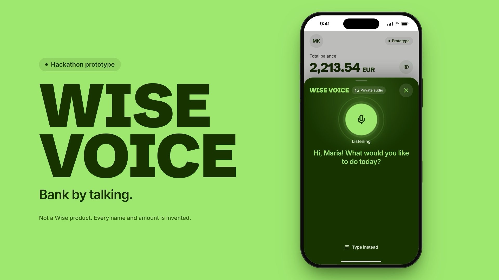

# wise-hackathon

**Wise Voice** is a hackathon prototype: a voice-first way to use Wise for people who find a screen
hard or impossible to read. Check your balance, send money and hear when money arrives, just by
talking. Every payment is read back, then approved with Face ID, and amounts are not read out on
the loudspeaker.

Not a Wise product. Every name and amount is invented.

- [`app/`](app/README.md): the phone-sized app front (React, Vite) with the demo bank.
- [`voice-agent/`](voice-agent/README.md): the ElevenLabs voice agent.
